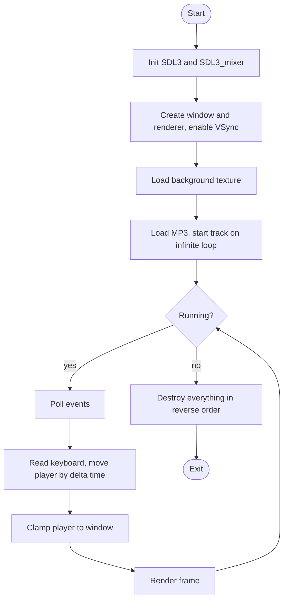

<div align="center">

# SPACE SHOOTER

### A 2D space shooter hand-forged in pure **C23** with **SDL3**

*No engine. No framework. Just a window, a pink square, and a very good soundtrack.*

<br>

[](https://en.cppreference.com/w/c/23)
[](https://libsdl.org)
[](Makefile)
[](https://kernel.org)
[](LICENSE)
[](#-roadmap)

<br>


<sub>The player (a very determined pink square) cruising through the nebula.</sub>

<br>

**[ Features](#-features) · [ Quick Start](#-quick-start) · [ Controls](#-controls) · [ Build System](#-build-system) · [ Under the Hood](#-under-the-hood) · [ Roadmap](#-roadmap) · [ License](#-license) · [ Credits](#-credits--assets)**

</div>

---

## Features

| | |
|---|---|
| **Smooth movement** | Delta-time based motion: the game feels identical at 30 FPS or 300 FPS |
| **Looping soundtrack** | MP3 streamed and looped forever through SDL3_mixer |
| **Textured backdrop** | PNG background rendered through SDL3_image |
| **Resizable window** | Stretch it however you like; the player stays inside the playfield |
| **VSync** | Locked to your monitor's refresh rate, so your CPU doesn't melt |
| **Paranoid debug builds** | AddressSanitizer + UndefinedBehaviorSanitizer enabled by default |
| **Zero bloat** | Plain C, one Makefile, three libraries |

---

## Quick Start

### 1. Install the dependencies

**Arch Linux**

```bash
sudo pacman -S base-devel clang sdl3 sdl3_image sdl3_mixer
```

> **Requirements:** a C compiler with `-std=c23` support (GCC 14+ or a recent Clang), GNU Make, and SDL3, SDL3_image and SDL3_mixer.
> `clang` is only needed for `make format`.
> On distributions that don't package SDL3 yet, [build the libraries from source](https://github.com/libsdl-org).

### 2. Clone the repository

```bash
git clone https://github.com/roland-yegon/space-shooter.git
cd space-shooter
```

### 3. Build and run

```bash
make run
```

> ⚠️ Run the game **from the project root**. Assets are loaded from relative paths (`static/...`), so launching the binary from anywhere else will fail to find them.

Prepare for launch.

---

## Controls

| Action | Keys |
|:---|:---:|
| Move up | <kbd>W</kbd> or <kbd>↑</kbd> |
| Move down | <kbd>S</kbd> or <kbd>↓</kbd> |
| Move left | <kbd>A</kbd> or <kbd>←</kbd> |
| Move right | <kbd>D</kbd> or <kbd>→</kbd> |
| Quit | <kbd>Esc</kbd> |

---

## Build System

Everything goes through `make`.

### Targets

| Command | What it does |
|:---|:---|
| `make` | Compiles the game into `build/debug/bin/Game` |
| `make run` | Builds (if needed) and launches the game |
| `make format` | Formats `src/` and `include/` with `clang-format` |
| `make clean` | Removes the `build/` directory |

### Options

| Variable | Default | Effect |
|:---|:---:|:---|
| `BUILD=release` | `debug` | Optimized build (`-O2`, `-DNDEBUG`, no sanitizers) in `build/release/` |
| `V=1` | `0` | Verbose mode: print the full compiler commands |
| `ARGS="..."` | empty | Arguments forwarded to the game by `make run` |

```bash
make BUILD=release run     # fast build, no sanitizers
make V=1                   # see exactly what the compiler is doing
```

### Build profiles

| | `debug` (default) | `release` |
|:---|:---:|:---:|
| Optimization | `-O0` | `-O2` |
| Debug symbols | ✅ `-g` | ❌ |
| AddressSanitizer | ✅ | ❌ |
| UndefinedBehaviorSanitizer | ✅ | ❌ |
| Warnings | `-Wall -Wextra -Wpedantic` | `-Wall -Wextra -Wpedantic` |

---

## Under the Hood



A few design notes:

- **Delta time:** movement is `speed × seconds since last frame`, never `speed × frames`.
- **Single exit path:** every failure jumps to one `cleanup:` label that tears resources down in **reverse creation order** (track → audio → mixer → texture → renderer → window), skipping anything that was never created.
- **Streaming audio:** the soundtrack is decoded as it plays instead of being loaded into RAM up front.

---

## Project Structure

```text
space-shooter/
├── src/
│   └── main.c              # Entry point, game loop, resource management
├── include/                # Headers (as the project grows)
├── static/
│   ├── images/
│   │   └── background_photo.jpg
│   └── music/
│       └── background_music.mp3
├── docs/
│   └── screenshot.png
├── .clang-format           # Code style (LLVM base, 4 spaces, 100 columns)
├── Makefile                # Build, run, format, clean
├── LICENSE                 # MIT
└── README.md
```

---

## Built With

- [**SDL3**](https://libsdl.org): windowing, input, rendering and timing
- [**SDL3_image**](https://github.com/libsdl-org/SDL_image): image loading
- [**SDL3_mixer**](https://github.com/libsdl-org/SDL_mixer): audio decoding, mixing and looping
- **C23**, **GNU Make**, **clang-format**

---

## Roadmap

- [x] Window, renderer and VSync
- [x] Textured background
- [x] Delta-time player movement with window clamping
- [x] Looping background music
- [x] Clean, leak-free shutdown (sanitizer-approved)
- [ ] Player sprite to replace the pink square
- [ ] Shooting
- [ ] Enemies and spawning
- [ ] Collision detection
- [ ] Score and lives
- [ ] Music controls (pause, volume, fade-out)
- [ ] Sound effects
- [ ] Title screen and game over screen

---

## Contributing

Ideas, bug reports and pull requests are welcome.

1. Fork the project
2. Create your branch: `git checkout -b feature/amazing-idea`
3. Run `make format` before committing
4. Make sure a **debug build runs clean** under the sanitizers
5. Commit your changes: `git commit -m "Add amazing idea"`
6. Push the branch: `git push origin feature/amazing-idea`
7. Open a pull request

---

## License

The source code is distributed under the **MIT License**. See [`LICENSE`](LICENSE) for details.

---

## Credits & Assets

The MIT License covers the **source code only**. The assets in `static/` are third-party and keep their own terms:

| Asset | Source | Terms |
|:---|:---|:---|
| **"Suspense"** by NastelBom | [Pixabay](https://pixabay.com/music/suspense-suspense-501709/) | [Pixabay Content License](https://pixabay.com/service/license-summary/) |
| **"CW Leonis Plows Ahead"** (GALEX ultraviolet image) | Credit: NASA/JPL-Caltech, via the [NASA Scientific Visualization Studio](https://svs.gsfc.nasa.gov/14866/) | [NASA Media Usage Guidelines](https://www.nasa.gov/nasa-brand-center/images-and-media/) |

> This project is not affiliated with or endorsed by NASA.

---

<div align="center">

**Built with C, and stubborn determination by [Roland Kibet Yegon](https://github.com/roland-yegon)**

If this project made you smile, drop it a star

</div>
