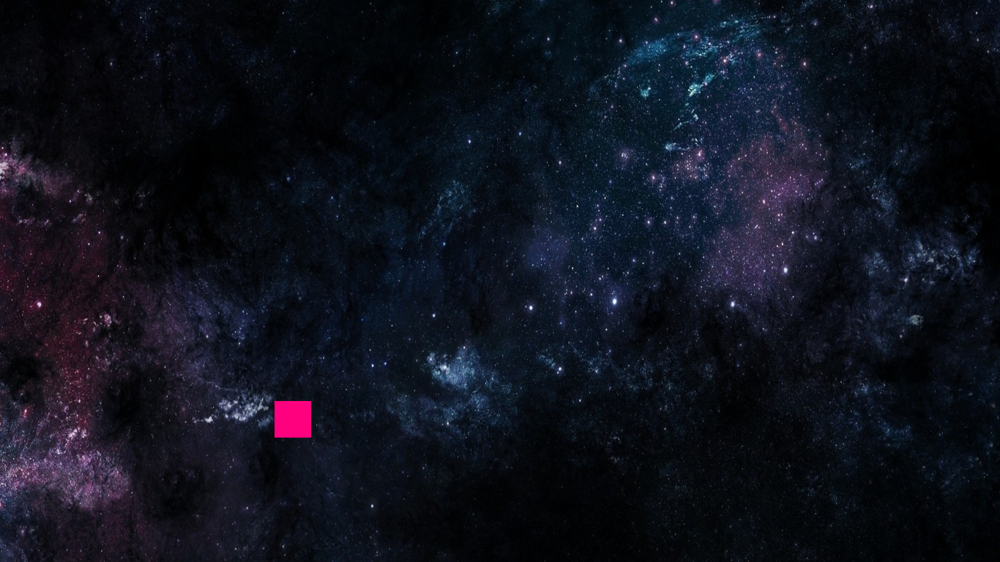

<div align="center">

# SPACE SHOOTER

### A blazing-fast 2D space shooter, hand-forged in pure **C** with **SDL3**

<br>

[](https://en.wikipedia.org/wiki/C_(programming_language))
[](https://libsdl.org)
[](https://kernel.org)
[](LICENSE)
[](#-roadmap)

<br>

<!--  Replace with a real screenshot or GIF: put it at docs/screenshot.png -->


<br>

**[Features](#-features) · [Quick Start](#-quick-start) · [Controls](#-controls) · [Build System](#-build-system) · [Roadmap](#-roadmap) · [License](#-license)**

</div>

---

## Features

| | |
|---|---|
| **Smooth movement** | Delta-time based motion, so the game feels the same at 30 FPS or 300 FPS |
| **Looping soundtrack** | Background music streamed and looped seamlessly through SDL3_mixer |
| **Textured backgrounds** | PNG backgrounds rendered through SDL3_image |
| **Resizable window** | Drag it, stretch it, and the player stays inside the playfield |
| **VSync** | Locked to your monitor's refresh rate, so your CPU doesn't melt |
| **Memory-safe dev builds** | Debug builds ship with AddressSanitizer enabled |
| **Zero bloat** | Plain C, a Makefile, and three libraries. No engine, no framework, no nonsense |

---

## Quick Start

### 1. Install the dependencies

**Arch Linux**

```bash
sudo pacman -S base-devel clang sdl3 sdl3_image sdl3_mixer
```

> `clang` is only needed for `make format`. On other distributions, install SDL3, SDL3_image and SDL3_mixer from your package manager, or [build them from source](https://github.com/libsdl-org).

### 2. Clone the repository

```bash
git clone https://github.com/roland-yegon/space-shooter.git
cd space-shooter
```

### 3. Build and run

```bash
make run
```

That's it. Prepare for launch. 🛸

---

## Controls

| Action | Keys |
|:---|:---:|
| Move up | <kbd>W</kbd> or <kbd>↑</kbd> |
| Move down | <kbd>S</kbd> or <kbd>↓</kbd> |
| Move left | <kbd>A</kbd> or <kbd>←</kbd> |
| Move right | <kbd>D</kbd> or <kbd>→</kbd> |
| Quit | <kbd>Esc</kbd> |

---

## Build System

Everything goes through `make`:

| Command | What it does |
|:---|:---|
| `make` | Compiles the game into `build/debug/bin/Game` |
| `make run` | Builds (if needed) and launches the game |
| `make format` | Formats the source with `clang-format` |
| `make clean` | Removes the `build/` directory |

---

## Project Structure

```text
space-shooter/
├── src/
│   └── main.c            # Game entry point and main loop
├── static/
│   ├── images/           # Backgrounds and sprites
│   └── music/            # Soundtrack
├── Makefile              # Build, run, format, clean
├── LICENSE               # MIT
└── README.md
```

---

## Built With

- [**SDL3**](https://libsdl.org): windowing, input, rendering and timing
- [**SDL3_image**](https://github.com/libsdl-org/SDL_image): image loading
- [**SDL3_mixer**](https://github.com/libsdl-org/SDL_mixer): audio playback and looping
- **C**, **GNU Make**, **clang-format**

---

## Roadmap

- [x] Window, renderer and VSync
- [x] Textured background
- [x] Delta-time player movement with window clamping
- [x] Looping background music
- [x] Clean, leak-free shutdown
- [ ] Player sprite to replace the pink square
- [ ] Shooting
- [ ] Enemies and spawning
- [ ] Collision detection
- [ ] Score and lives
- [ ] Music controls (pause, volume, fade-out)
- [ ] Sound effects
- [ ] Title screen and game over screen

---

## Contributing

Ideas, bug reports and pull requests are welcome.

1. Fork the project
2. Create your branch: `git checkout -b feature/amazing-idea`
3. Run `make format` before committing
4. Commit your changes: `git commit -m "Add amazing idea"`
5. Push the branch: `git push origin feature/amazing-idea`
6. Open a pull request

---

## License

Distributed under the **MIT License**. See [`LICENSE`](LICENSE) for details.

---

<div align="center">

**Built with C, and stubborn determination by [Roland Kibet Yegon](https://github.com/roland-yegon)**

If this project made you smile, drop it a heart

</div>
